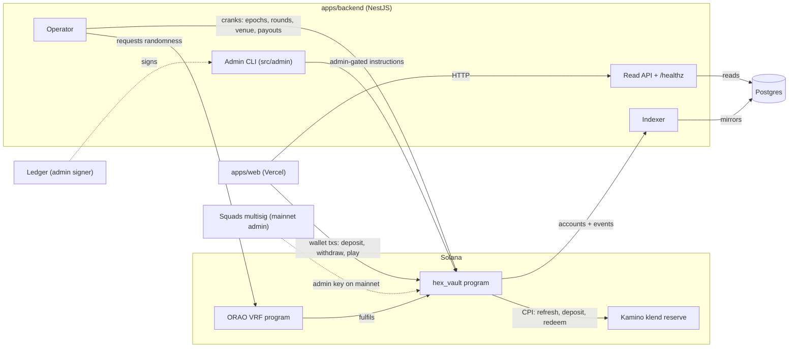
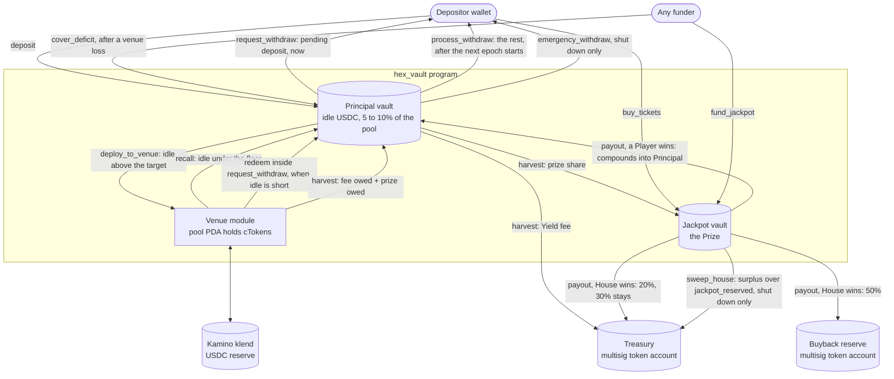
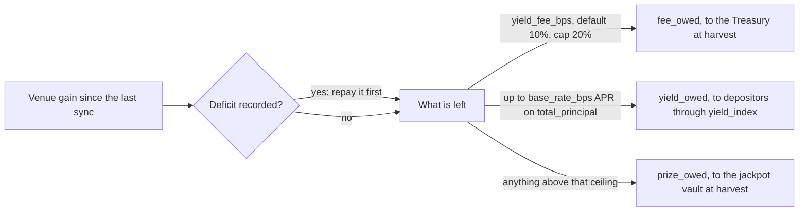
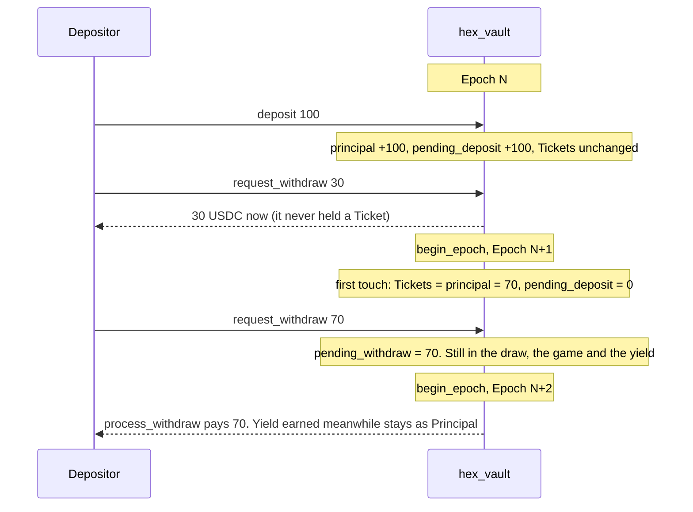
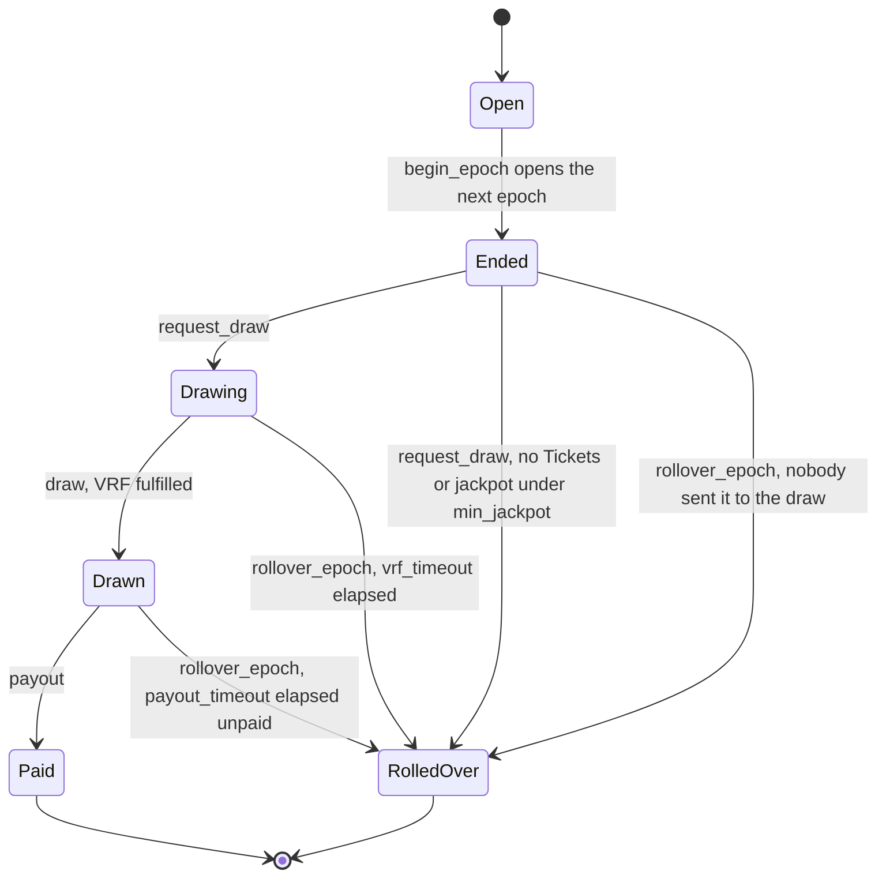
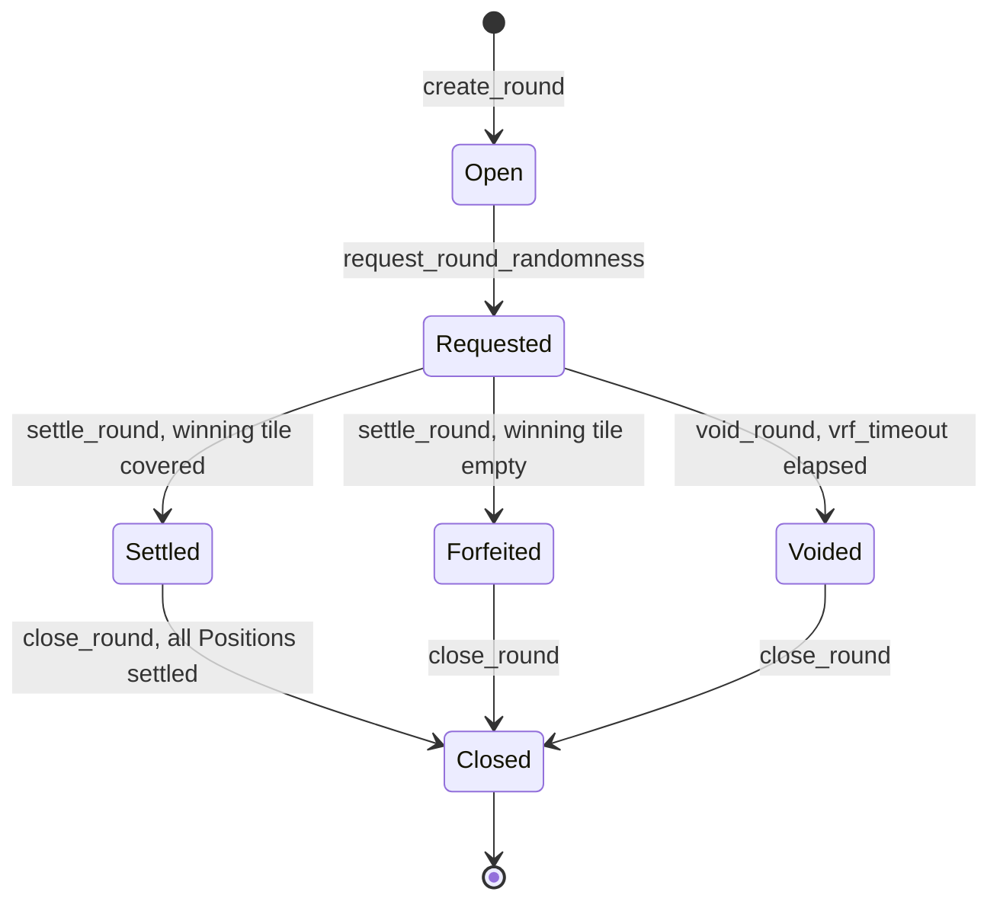

# Architecture

HexVault is one Anchor program (`hex_vault`), a NestJS backend that cranks it and mirrors it
into Postgres, and a Vite/React frontend that only ever reads from the backend. See
[`GLOSSARY.md`](../GLOSSARY.md) for vocabulary and [`docs/adr/`](adr/) for why things are shaped
this way. The money design is ADR 0017 (live yield), the draw is ADR 0018 (Fenwick tree) and
ADR 0020 (Tickets count from the next epoch), the game is ADR 0019.

## Components



The operator's hot key also owns the House `Player`. The admin key (a Squads multisig on
mainnet, a Ledger locally) never runs on the backend box.

There is no separate adapter program. The venue is a module inside `hex_vault`
(`venue.rs`, three operations: `value`, `deposit`, `redeem`), backed by klend in `klend.rs` and
by a kVault in `kvault.rs` and by a stub in `test_venue.rs` on localnet. The pool PDA holds the
klend cTokens or the kVault shares itself. A new kind of backing still means a program upgrade.
Pointing a pool at another klend reserve or kVault does not: the four venue addresses sit on the
`Pool` and only `migrate_venue` rewrites them, after a proposal and a 48 hour lock (ADR 0023).

## Fund flow



What the picture cannot show:

- **Depositor yield never moves as its own transfer.** It stays in the venue and is credited
  through `Pool.yield_index`. A Player's share lands in their `principal` the next time any
  instruction touches them (settle). It leaves as USDC only inside a withdrawal.
- **Harvest is one instruction.** It redeems the fee owed plus the prize share owed from the
  venue into the principal vault and pays both out in the same transaction, so nothing rests
  in the vault between the two hops.
- **A Player's prize compounds.** `payout` moves the jackpot into the principal vault and adds
  it to the winner's `principal` and Tickets at once. Nothing is sent to the winner's wallet.
- **Deposit sends nothing back.** Tickets are a number on the `Player`, not a token (ADR 0001).
- **The game moves no USDC.** Rounds move Tickets between Players and the House only.

### How a venue gain is split

Every instruction that touches money runs `sync` first. Sync values the cTokens at the
reserve's exchange rate and compares that with `Pool.venue_value` from the last sync.



The depositor rate is variable with a ceiling. Depositors get what the venue paid after the
fee, up to `base_rate_bps` as an APR. Whatever the venue pays above the ceiling is the prize.
When the venue pays less than the ceiling the prize share is zero and the jackpot grows only
from `buy_tickets`, `fund_jackpot` and the 30% a House win leaves behind.

A fall in venue value past `loss_tolerance_bps` (1 bps) is a venue loss. `prize_owed` absorbs it
first, then `fee_owed`, and what is left becomes `Pool.deficit` with `impaired = true`. While
impaired, deploy, harvest and `deposit` are refused and every exit pays the Haircut,
`amount x (vault + venue value - owed amounts) / total_principal`. `process_withdraw` and
`emergency_withdraw` then need the owner's signature, so a stranger or the Operator's crank
cannot realise a Haircut for someone who would rather wait. The Operator skips its withdrawal
crank while the pool is impaired. `request_withdraw`, `recall` and `cover_deficit` still work,
and a Prize paid while impaired still compounds. A later gain or `cover_deficit` repays the
deficit and clears the flag (ADR 0021).

### Idle band and deploy caps

| Rule | Default | Bound | Where |
| --- | --- | --- | --- |
| Free idle = vault balance minus `pending_withdrawals` | | | `deploy_to_venue`, `recall`, `request_withdraw` |
| Recall is allowed while free idle is under the target, and may not overshoot it | 10% | | `recall` |
| The Operator recalls only once free idle is under the floor | 5% | floor <= target | `apps/backend/src/operator/venue.ts` |
| Deploy only what sits above the target | 10% | target <= 50% | `deploy_to_venue` |
| Pool's share of the reserve's supply | 5% | <= 20% | `check_deploy_caps` |
| Free liquidity the reserve keeps after a deploy | 2x our position | 1x to 6x | `check_deploy_caps` |
| Smallest deploy or recall | 100 USDC | <= 10,000 USDC | `min_venue_move` |

`deploy_to_venue`, `recall` and `harvest` take no privileged signer. The program enforces the
band and the caps, so the Operator runs them as a convenience and anyone else could.
`set_deploy_pause` stops deploys (Admin or Operator sets it, only the Admin clears it).

### The solvency invariant

After every instruction, within rounding dust:

```
vault balance + venue value >= total_principal + yield_owed + fee_owed + prize_owed - deficit
```

`pending_withdrawals` is not a term. A queued withdrawal stays inside `total_principal` until
it pays, so the queue is a reservation of idle USDC and not a second claim. `/status` reports
the margin as `solvencyMargin` and alerts when it goes negative.

## Tickets, deposits and withdrawals

USDC a Player holds at the start of an epoch is their Tickets for that epoch (ADR 0020).



- **Principal** earns Tickets from the epoch after the deposit. Settled yield, Bought tickets,
  Granted tickets, round rewards and the Prize credit Tickets at once.
- **`request_withdraw(amount)`** is the only exit. The part up to `pending_deposit` refunds in
  the same transaction, redeeming from the venue if free idle is short. The rest queues and
  matures when `current_epoch_id` passes the request's epoch, or after `epoch_seconds` if the
  Operator stops calling `begin_epoch`.
- **`process_withdraw`** is permissionless and pays to the owner's own token account. It
  lowers Principal, and Tickets with a floor at zero, so a Player who lost Tickets in the game
  still gets every unit of Principal.
- **`touch`** is the lazy reset. The first time anything touches a Player in a later epoch,
  Tickets are set to Principal. Nothing sweeps Players at the boundary.

### The Weight tree

The draw selects over a Fenwick tree in one zero-copy account (`weight.rs`, `weight_tree.rs`).
Each Player owns one Leaf, appended on their first deposit, and the depositor pays its rent.
The House owns Leaf 1. A node is 56 bytes: `principal_sum` plus two epoch-parity slots, each a
stamp, a base and a Ticket count. A write in epoch `e` uses slot `e % 2`, so the epoch that
just ended stays readable until `begin_epoch` runs a second time. A Player who never acts needs
no transaction: a read for epoch `p` takes the slot stamped `p`, else the base of the slot
stamped `p + 1`, else the live `principal_sum`. The account tops out at 10 MiB,
about 187,000 Leaves.

## Accounts and PDAs

All seeds are declared in `programs/hex_vault/src/constants.rs`. `pool_id`, `epoch_id` and
`round_id` are little-endian `u64` bytes.

| Account | Seeds | Created by |
| --- | --- | --- |
| `Pool` | `["pool", pool_id]` | `create_pool` |
| Principal vault (token account) | `["principal", pool]` | `create_pool` |
| Jackpot vault (token account) | `["jackpot", pool]` | `create_pool` |
| `Player` (including the House) | `["player", pool, owner]` | `deposit` (`init_if_needed`); the House's own `Player` is created by `create_pool` with `params.operator` as `owner` |
| `WeightTree` | none, a keypair account | a `system_program::create_account` in the `create_pool` transaction, then grown one node per first deposit |
| `Epoch` | `["epoch", pool, epoch_id]` | `begin_epoch` |
| `Round` | `["round", pool, round_id]` | `create_round` |
| `Position` | `["position", round, owner]` | `buy_position` |

`treasury` and `buyback_reserve` are plain token accounts passed into `create_pool` and changed
by `set_treasury_accounts`. On mainnet they are the admin multisig's own associated token
accounts. `klend_program`, `klend_market`, `klend_reserve` and `klend_ctoken` (the pool's cToken
account) are set at `create_pool` and change only through `migrate_venue` (ADR 0023). Every
instruction that syncs checks the accounts it was handed against them. For a kVault pool the
four hold the kVault program, the vault state, the shares mint and the pool's shares account.

`Pool`, `Player`, `Round` and `Position` are layout version 2 with their own discriminators
(`HVPool02` and so on), so a version-1 account fails to load instead of being misread. Each
carries a `version: u8` and a `_reserved` byte array for append-only growth (ADR 0013).

## Roles

"Anyone" means the instruction checks no role. Where the table says so there may still be a
fee-paying signer, but the outcome is pinned by seeds or an `address` constraint, so nobody can
steer it by being the one who sends the transaction.

| Instruction | Who signs | Notes |
| --- | --- | --- |
| `create_pool` | payer | Bootstrap only, one time per pool. Game and jackpot start paused |
| `set_params`, `set_venue_params`, `set_treasury_accounts` | admin | Venue params are bounded by program constants |
| `set_pause(true)`, `set_feature_pause(.., true)`, `set_deploy_pause(true)` | admin or operator | |
| `set_pause(false)`, `set_feature_pause(.., false)`, `set_deploy_pause(false)` | admin only | Unpause is refused while shut down |
| `set_buy_tickets_pause` | admin | Both directions |
| `shutdown` | admin | Irreversible |
| `set_operator`, `propose_admin` | admin | |
| `accept_admin` | the proposed `pending_admin` | Two-step handover |
| `deposit` | owner | Refused while paused, shut down or impaired |
| `request_withdraw` | owner | Allowed while paused and while shut down |
| `process_withdraw` | anyone, or the owner while impaired | Destination is pinned to `player.owner`. Fails while the Player has a Position open |
| `emergency_withdraw` | anyone, or the owner while impaired | Only valid while shut down; destination pinned to `player.owner`; House excluded |
| `sweep_house` | admin | Only valid while shut down |
| `buy_tickets` | owner | Capped per epoch at the Player's Principal |
| `grant_tickets` | admin or operator | Operator path is capped per Player and pool-wide; admin path is not |
| `deploy_to_venue`, `recall`, `harvest` | anyone | Bounded by the idle band and the deploy caps |
| `cover_deficit` | anyone (payer) | Capped at the recorded deficit |
| `begin_epoch`, `request_draw` | operator | |
| `fund_jackpot` | anyone (source authority) | Permissionless top-up |
| `draw` | anyone | Reads the fulfilled ORAO account pinned by the epoch's seed |
| `payout` | anyone | Winner is checked against the tree, destinations are pinned on the Pool |
| `rollover_epoch` | anyone | Only after the relevant timeout |
| `create_round` | operator | |
| `buy_position` | owner | Refused if the round would end after the epoch ends |
| `request_round_randomness` | anyone (pays the ORAO fee) | |
| `settle_round` | anyone | The House credit is pinned to `pool.operator`'s Player |
| `settle_position` | anyone | Rent returns to the Position's own owner |
| `void_round` | anyone | Only after `vrf_timeout` |
| `close_round` | anyone | Rent returns to `pool.operator`; refuses while any Position is open |

## Epoch lifecycle



`request_draw` snapshots two things: the tree's root for the ended epoch, and the jackpot vault
balance minus `jackpot_reserved`. It then adds the snapshot to `jackpot_reserved`, so the next
epoch cannot promise the same USDC. `payout` and `rollover_epoch` release it. `request_draw` is
refused after `shutdown`, but `draw` and `payout` are not, so an epoch already Drawing still
reaches its winner.

## Round lifecycle



A stake leaves the Player's Tickets at `buy_position` and comes back with the reward at
`settle_position`. Winners split the losers' pot minus `house_cut_bps`, a forfeited pot goes to
the House, a void refunds. A round always ends inside its epoch. A settle that lands after the
epoch rolled credits only the winner's share, because the reset already restored the stake.
`close_round` refuses while `Round.open_positions` is nonzero, then returns the rent to
`pool.operator`.

## Backend jobs and the indexer read model

The operator (`apps/backend/src/operator`) is deadline-driven: it sleeps until the next moment a
decision could change, with a 60-second safety tick as a backstop. Each tick runs at most one
step:

1. Settle a `Round` whose randomness is due.
2. Sweep unsettled `Position`s on a terminal `Round`.
3. Close a terminal `Round` once nothing settled on it is still owed (`close_round`).
4. `begin_epoch`, once the round and sweep steps above are clear.
5. Grant the daily referral bonus, once per epoch.
6. `request_draw` for the epoch that just ended, which snapshots the Weight tree and the jackpot
   vault and asks for randomness (or rolls the epoch over).
7. Await the draw's randomness, then `draw`.
8. `payout` the winner, found by reading the Weight tree and the Player accounts.
9. Venue cranks: `harvest` once per epoch in its last 10 minutes, `recall` when free idle is under
   the floor, `deploy_to_venue` when it is above the target. A failed crank is cooled down for 10
   minutes and never holds anything else up.
10. Pay out matured withdrawal requests (`process_withdraw`), batched.
11. Open the next `Round`, if a whole one still fits before the epoch ends.

Steps 4 through 7 and 11 stop once `pool.shutdown` is true, mirroring which instructions the
program itself refuses (`begin_epoch`, `request_draw`, `create_round`); deploy stops too, while
recall and harvest keep running. Steps 1 through 3, 8 and 10 keep running: settling, closing and
sweeping an already-open `Round`, `payout` of an epoch already `Drawn`, and matured withdrawals
are all still allowed post-shutdown (`docs/ops/funds.md` covers what to do about the ones that
were not). Every operator transaction carries a priority fee: the 75th percentile of
`getRecentPrioritizationFees` over the transaction's writable accounts, capped at
`PRIORITY_FEE_MAX_MICROLAMPORTS` (default 50,000).

The indexer (`apps/backend/src/indexer`) mirrors `Pool`, `Epoch`, `Round`, `Player` and
`Position` accounts plus finalized events into Postgres (ADR 0008); it is the only read path the
browser has; there is no chain fallback. A `Round` row keeps its last mirrored state after
`close_round` closes the account on chain instead of being deleted. The indexer also tracks
invite codes and redemptions, referral qualification, faucet claims and its own cursor.

`GET /status` reports the solvency margin, free idle against the band, the impaired and
deploy-paused switches, the tree's used capacity and the count of pending deposits waiting to
activate. `GET /healthz` reports the operator's SOL balance and turns `degraded` below
`OPERATOR_SOL_WARN` (default 0.5 SOL).

See [`docs/ops/deploy.md`](ops/deploy.md), [`docs/ops/funds.md`](ops/funds.md) and
[`docs/ops/environments.md`](ops/environments.md) for running and operating this.
